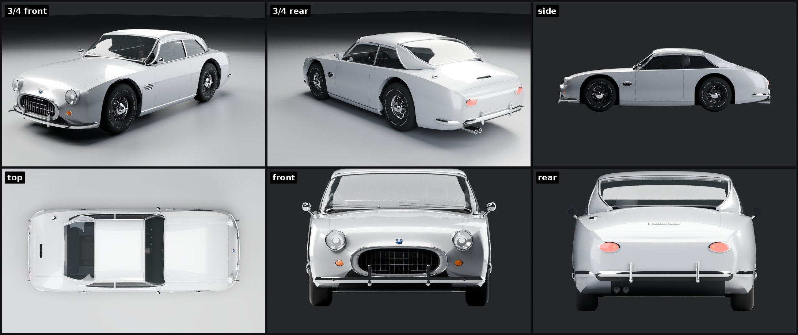
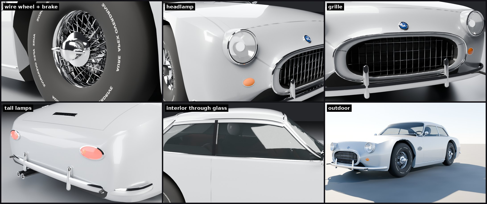
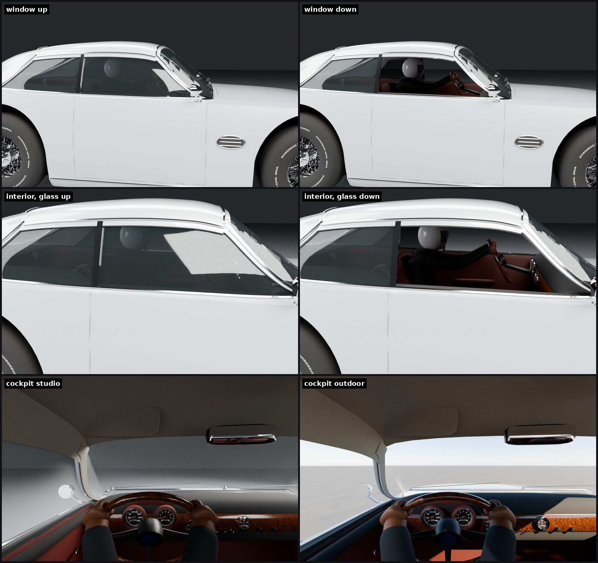
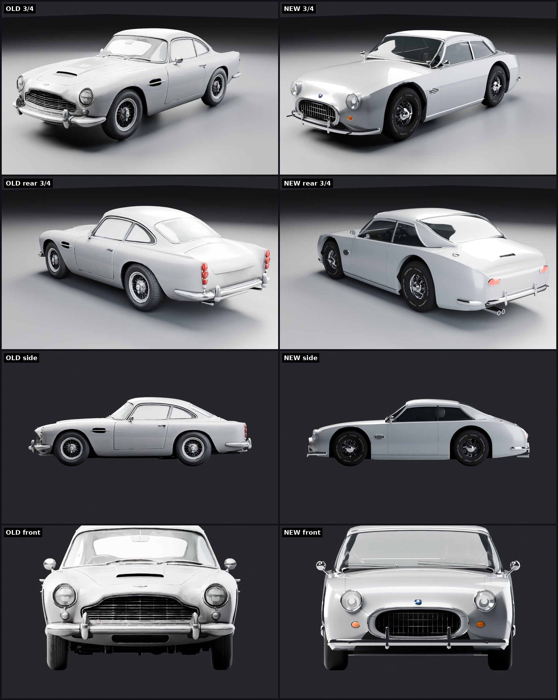
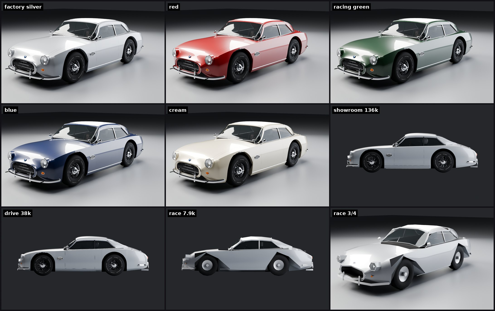
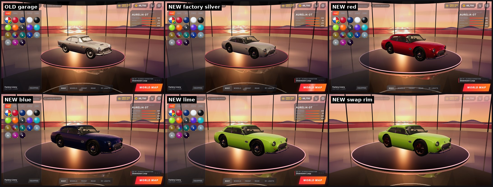
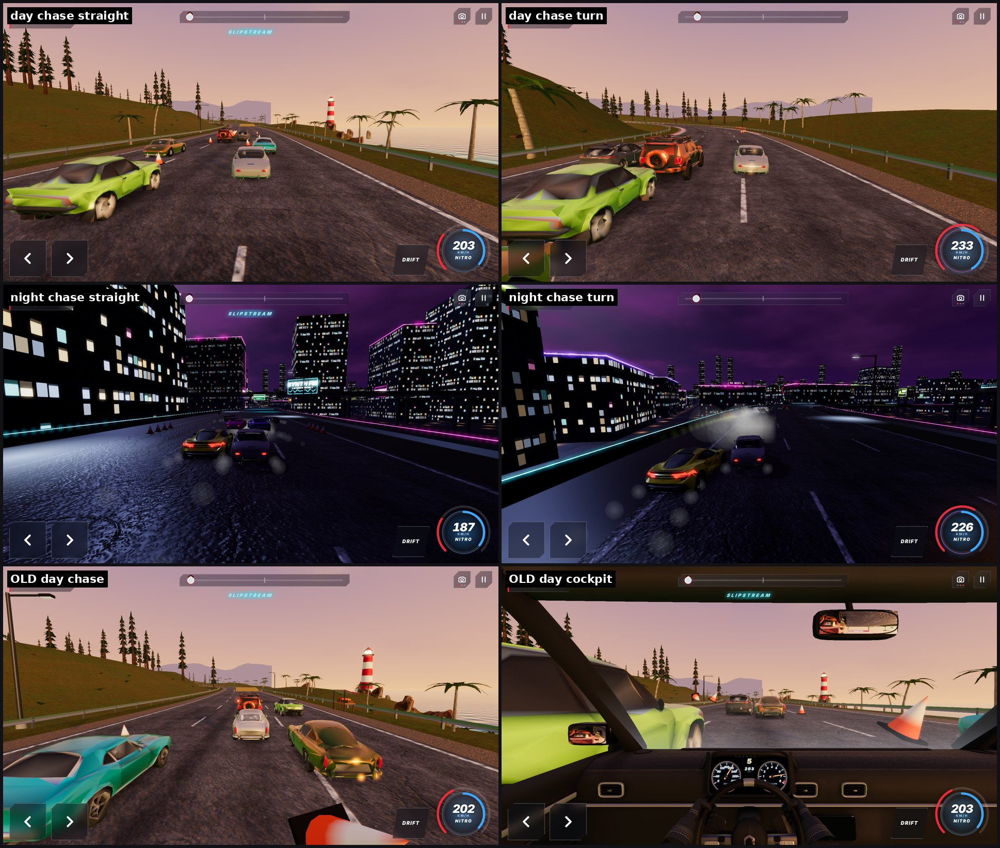
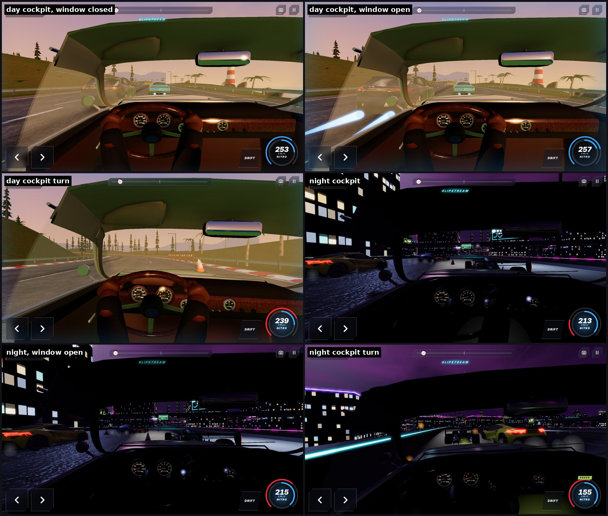
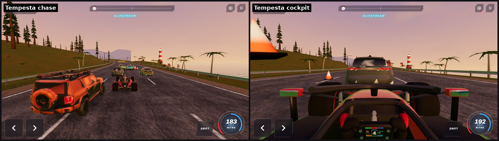
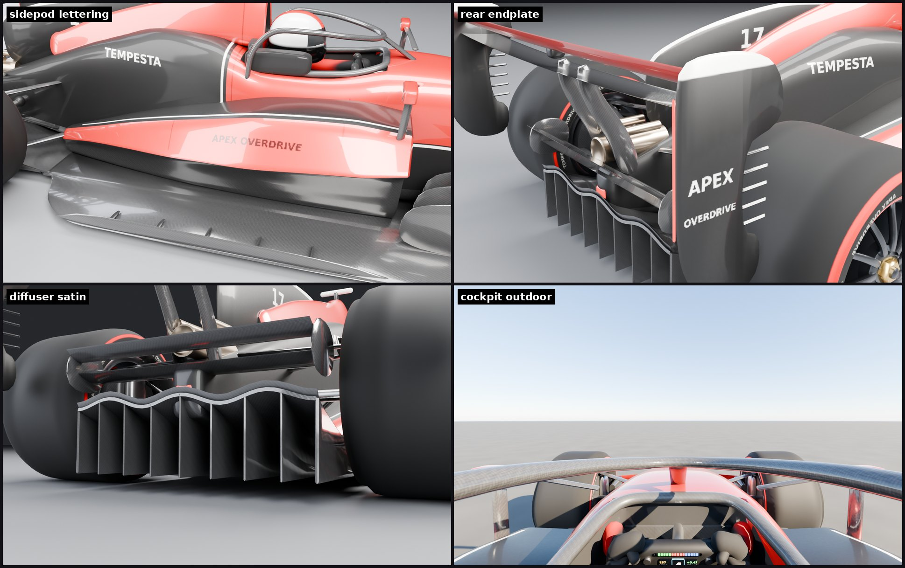

# পাইলট ২ — Aurelia GT (প্রথম বন্ধ গাড়ি, শুধু অনুমোদনের জন্য ছবি)

**ব্রাঞ্চ:** [`pilot/aurelia`](https://github.com/imroulofficial/apex-overdrive-3d/tree/pilot/aurelia), `pilot/tempesta` থেকে তৈরি। একই পাইপলাইন ব্যবহার করে আরও বাড়ানো হয়েছে। কোনো PR খোলা হয়নি, কোনো merge হয়নি। main আর workflows ছোঁয়া হয়নি।
**গেম কোড:** `src/` এর কোনো পরিবর্তন commit করা হয়নি। গেমের স্ক্রিনশট নিতে অস্থায়ী লোডার patch শুধু লোকালি চালানো হয়েছিল, তারপর `git checkout src` দিয়ে ফেরত নেওয়া হয়েছে। patch টা ফাইল হিসেবে রাখা আছে: `tools/cars/preview-loader.patch`। এখন এটা গাড়ি অনুযায়ী কাজ করে: গাড়ির নিজস্ব ককপিট ফাইল, ককপিটে কোন নোড লুকাবে, আর জানালা ওঠা-নামা।
**আগের রিপোর্ট:** Tempesta রিভিশন ২ এর রিপোর্ট আর ছবি অপরিবর্তিত আছে। এই রিপোর্টের শেষে Tempesta-র ছোট ফিক্সগুলোর ছবি আছে।

---

## ১. সংক্ষেপে

- **ডিজাইন:** নিজস্ব ক্লাসিক GT কুপে, ৪.৬০ মি, Class B। লম্বা বনেট, fastback ছাদ, ডিম্বাকার গ্রিল মুখ, উইংয়ে বসানো গোল হেডল্যাম্প, সামনের চাকার পেছনে সাইড ভেন্ট, ক্রোম ব্লেড বাম্পার আর overrider, ক্রোম ফ্রেমের পাতলা কাচের ঘর, অনুভূমিক ডিম্বাকার টেল ল্যাম্প, wire wheel।
  - কোনো আসল কোম্পানির আকার, লোগো বা নাম নেই। পুরোনো মডেলটা (আসল একটা গাড়ির খুব কাছাকাছি) শুধু মাপের জন্য দেখা হয়েছে, কপি করা হয়নি।
  - লেখা শুধু গাড়ির আর গেমের নিজের: বুটের প্লেটে **AURELIA**, নাকের নীল এনামেল ব্যাজে **AO**, টায়ারে **APEX OVERDRIVE / AURELIA GT**।
- **মাপ পুরোনোটার মতোই, যাতে ফিজিক্স না বদলায়:**
  - দৈর্ঘ্য ঠিক ৪.৬০ মি। bounding box −২.৩০ থেকে +২.৩০, তাই গেমের স্কেল ১.০ থাকে।
  - হুইলবেস ২.৪৯৫ মি, সামনের অক্ষ x +১.৪০৩, পেছনের −১.০৯২।
  - চাকার ব্যাসার্ধ সামনে ০.৩৭২, পেছনে ০.৩৭৮। half-track ০.৭৭০।
- **বডি:** পরিষ্কার শোল্ডার লাইন, প্যানেল গ্যাপ (দরজা, বনেট, বুট, ফুয়েল ক্যাপ) পেইন্ট ম্যাপে শেড হিসেবে আছে। ক্রোম দরজার হ্যান্ডেল, বুলেট মিরর, সিল ট্রিম, ওয়াইপার, জোড়া ক্রোম এক্সহস্ট।
- **লাইট:**
  - হেডল্যাম্প: পেইন্টের বাকেট, ক্রোম বেজেল, খাঁজকাটা ক্রোম রিফ্লেক্টর, মাঝে বাল্ব শিল্ড (`headlight_lens`), উপরে পরিষ্কার কভার কাচ।
  - টেল ল্যাম্প: লাল লেন্স (`taillight_lens`), ক্রোম বেজেল, অ্যাম্বার অংশ।
  - সামনে অ্যাম্বার ইন্ডিকেটর।
  - `headlight_lens` আর `taillight_lens` চারটা LOD-এই আছে।
- **চাকা:**
  - ৭২ স্পোকের wire wheel (ড্রাইভ LOD-এ ৪৮)। প্রতিটা স্পোক আলাদা দেখা যায়।
  - ক্রোম knock-off স্পিনার।
  - পেছনে নিরেট ডিস্ক আর গাঢ় ধূসর ক্যালিপার upright-এ বসানো।
  - রেস LOD-এ সাধারণ ডিস্ক রিম।
- **কাচ:** উইন্ডস্ক্রিন, পেছনের কাচ, কোয়ার্টার আর দরজার কাচ হালকা টিন্ট করা ও স্বচ্ছ (alpha ০.৪২)। বাইরে থেকে ভেতরের কেবিন দেখা যায়।
  - ভেতরের কেবিন (`interior`): শোরুমে সিট, ড্যাশ, গেজ, কনসোল, হেডলাইনার। ড্রাইভ LOD-এ সরল, রেস LOD-এ শুধু ড্যাশ আর সিট।
- **খোলা যায় এমন জানালা:**
  - `window_L` আর `window_R` আলাদা নোড।
  - খোলার সময় কাচ প্রথমে বেল্ট লাইনের চারপাশে সোজা হয়, তারপর দরজার ভেতরে নেমে যায়। বাইরের চামড়া আর ভেতরের ডোর কার্ডের মাঝে থাকে, কোথাও ফুঁড়ে বের হয় না (সংখ্যায় যাচাই করা)।
  - বন্ধ আর খোলা অবস্থান extras-এ আছে: `extras.apex.windows.window_L/R.open = {position, quaternion}`।
  - ককপিট ফাইলেও আলাদা `window_L` / `window_R` (পরিষ্কার কাচ) আছে, একই অবস্থান ব্যবহার করে।
- **নিজস্ব ককপিট (`ag_aurelia_cockpit.glb`):**
  - ক্লাসিক GT কেবিন: চামড়ায় মোড়া ড্যাশ, burr-wood ফ্যাসিয়া।
  - গেজ: চারটা গোল ডায়াল (KM/H, RPM, OIL, WATER) আর একটা ঘড়ি, ডায়ালে আসল লেখা আছে।
  - স্টিয়ারিং আর হাত: কাঠের রিমের তিন স্পোক স্টিয়ারিং, ট্যান চামড়ার গ্লাভস পরা হাত, নেভি জ্যাকেটের হাতা।
  - কেবিনের বাকিটা: কনসোল আর গিয়ার লিভার, ডোর কার্ড (আর্মরেস্ট, জানালার হাতল, ক্রোম রিলিজ, ম্যাপ পকেট), A-পিলারের ট্রিম, হেডলাইনার, সান ভাইজর।
  - রিয়ার-ভিউ মিরর আর দুই দরজার মিররের কাচ `MirrorGlass`, প্রতিটার নিজস্ব 0..1 UV, লাইভ মিররের জন্য তৈরি।
- **চোখের অবস্থান:** বাঁহাতি ড্রাইভ, x −০.৩৩, y ১.১৬, z −০.৩৭। বনেট আর দুই উইং উইন্ডস্ক্রিনের নিচে দেখা যায়, রাস্তা পরিষ্কার দেখা যায়। ককপিট ভিউতে বাইরের `interior`, `driver`, `steering_wheel`, `glass`, `window_L/R` লুকানো থাকে (`extras.apex.hideInCockpit`)।
- **চুক্তি আগের মতোই:** নোডের নাম, চাকার origin অক্ষের উপর, প্রতি অক্ষে আলাদা ব্যাসার্ধ, upright-এ ডিস্ক আর ক্যালিপার, `steering_wheel` নোড, CarPaint জোন আর কারখানার লিভারি (সিলভার), open edges = 0, গোল চাকা।

## ২. স্ট্যাটস (`tools/cars/out/ag_aurelia-stats.json`)

| LOD | ফাইল | ত্রিভুজ / সীমা | সাইজ / সীমা | open edges |
|---|---|---|---|---|
| শোরুম | `ag_aurelia.glb` | **136,464** / 150,000 | **1,725 KB** / 1,758 KB (1.8 MB) | **0** |
| ড্রাইভ | `ag_aurelia_drive.glb` | **37,896** / 40,000 | **622 KB** / 635 KB (0.65 MB) | **0** |
| রেস (রাইভাল) | `ag_aurelia_race.glb` | **7,862** / 8,000 | **111 KB** / 322 KB (0.33 MB) | **0** |
| ককপিট | `ag_aurelia_cockpit.glb` | 30,268 / 60,000 | 510 KB / 1.5 MB | 0 |

- **চাকা:** ব্যাসার্ধ সামনে ০.৩৭২, পেছনে ০.৩৭৮ (তিন LOD-এই একই)। গোলত্ব শোরুম ০.৯৯০, ড্রাইভ ০.৯৯৫, রেস ১.০০।
- **Bounds:** x −২.৩০ … +২.৩০, উচ্চতা ১.৩৯, প্রস্থ ১.৯২ (মিরর সহ)।
- **ম্যাটেরিয়াল (শোরুমে ১২টা):** CarPaint, Body, Interior (নতুন), Gauges (নতুন), Glass, ClearGlass (নতুন, ল্যাম্প কভার), MirrorGlass, Tyre, Rim, Driver, headlight_lens, taillight_lens।
- **টেক্সচার:**
  - শোরুম: Body 2048² base + 1024² ORM + 1024² normal; CarPaint 1024²; Interior 512²; Gauges 512²; Tyre 1024²; Rim আর Driver 512²।
  - ড্রাইভ: Body 1024² + 512² ORM (ক্রোমের জন্য) + 256² normal; বাকিগুলো 256–512²।

## ৩. স্টুডিও রেন্ডার, ৬ দিক থেকে (Cycles)

## ৪. ক্লোজ-আপ: চাকা আর ব্রেক, হেডল্যাম্প, গ্রিল, টেল ল্যাম্প, কাচের ভেতর দিয়ে কেবিন, বাইরের আলো

## ৫. জানালা ওঠানো বনাম নামানো, আর ককপিট ভিউ

## ৬. পুরোনো বনাম নতুন, একই অ্যাঙ্গেল থেকে

## ৭. ৪টা রং + কারখানার সিলভার, আর LOD তুলনা

(স্টুডিওর বড় সফটবক্সের প্রতিফলনে ছাদ আর পাশগুলো রঙিন গাড়িতেও হালকা দেখায়। এটা আলোর কারণে, পেইন্ট ম্যাপে কোনো দাগ নেই।)

## ৮. গেমের ভেতরে (অস্থায়ী লোডার)

গ্যারেজ (কারখানার সিলভার, ৩টা প্লেয়ার রং, সোয়াপ রিম; পুরোনোটা বাঁয়ে উপরে):

রেস, চেজ ক্যামেরা, দিন (Emerald Coast) আর রাত (Neon City), সোজা আর মোড়ে; নিচে পুরোনো গাড়ি:

ককপিট ভিউ, দিন আর রাত, জানালা বন্ধ আর খোলা, মোড়ে:

Tempesta আবার গেমে (চেজ আর ককপিট), ফিক্সের পরে:

- গেমের ককপিটে রাস্তা পরিষ্কার দেখা যায়, উইন্ডস্ক্রিনের ফ্রেম, A-পিলার, রিয়ার-ভিউ মিরর আর দরজার মিরর আছে। কাঠের স্টিয়ারিং আর ডায়াল পড়া যায়।
- জানালা খুললে দরজার কাচ (বাঁয়ের হালকা পর্দা) সরে যায়। খোলা অবস্থার ছবিতে বাঁয়ে নীল দাগগুলো নাইট্রোর ইফেক্ট, কাচ নয়।
- patch-এ একটা বাগ পাওয়া গেছে আর ঠিক করা হয়েছে: প্যাকার প্রতিটা নোডে dequantisation offset দেয়, তাই জানালার অবস্থান নোডের নিজের transform-এর উপরে বসাতে হয়। প্রথমবার তা না করায় ককপিটে গাড়ি ৩৭ সেমি উঁচু হয়ে গিয়েছিল। এটা গেমে আনার সময় মনে রাখা দরকার।

## ৯. Tempesta-র ছোট ফিক্স (একই পাইপলাইনে আবার বিল্ড করা)

- **লেখা কাটা যাওয়া:** সাইডপডের "APEX OVERDRIVE" এখন ক্রেস্টের নিচে না গিয়ে পুরোটা পেইন্ট ফ্ল্যাশের সমতল অংশে বসে। পেছনের এন্ডপ্লেটে "APEX / OVERDRIVE" দুই লাইনে, শেষ অক্ষরও পুরো দেখা যায়।
- **ডিফিউজারের ঝিলিক:** ফেন্স আর gurney এখন satin কার্বন (রাফনেস ০.৪–০.৫, clear-coat নেই)।
- **ককপিটে কার্বনের কিনারায় সবুজ আভা:** ককপিটের চারপাশের কার্বন (coaming) satin করা হয়েছে, তাই আর ঘাসের প্রতিফলন দেখায় না।
- **মিরর:** হাউজিং একটু ছোট (০.০২৮ × ০.০২৯ × ০.০৭৪), কাচ planar UV সহ, লাইভ মিররের জন্য তৈরি, কোনো রঙিন ব্লক নেই।
- **নতুন স্ট্যাটস:** শোরুম 136,928 ত্রিভুজ / 1,643 KB, ড্রাইভ 38,972 / 604 KB, রেস 7,574 / 104 KB, ককপিট 7,844 / 288 KB, open edges 0।

## ১০. দুর্বল দিক (সৎ মূল্যায়ন)

1. **পুরোনো মডেলের তুলনায় আকার কম মার্জিত।** পুরোনোটা একটা আসল গাড়ির খুব নিখুঁত স্ক্যানের মতো ছিল (সেজন্যই নতুন করা দরকার)। নতুনটা নিজস্ব, কিন্তু:
   - কাচের ঘর একটু উঁচু আর চৌকো দেখায়।
   - পাশগুলো সমতল।
   - পেছনটা গোল, পুরোনোটার মতো স্পষ্ট বুট লিড আর উঁচু haunch নেই।
   - পরের রিভিশনে ছাদ ২–৩ সেমি নামানো আর টাম্বলহোম বাড়ানো যায়।
2. **টায়ারের লেখা:** একটা শব্দ কাটা পড়েছে ("AURE…")। টেক্সচারের স্ট্রিপে শব্দগুলো ঠিকমতো আঁটেনি, পরের বিল্ডে শব্দ ছোট করলে ঠিক হবে।
3. **চাকার খিলান:** সামনের চাকার সামনে খিলানের ভেতরের দেয়াল কিছু অ্যাঙ্গেলে গাঢ় কীলকের মতো দেখায়। ড্রাইভ LOD-এ পেছনের খিলানের কাছে হালকা দাগ আছে।
4. **ককপিট:**
   - FOV ৭০° বলে ছাদের হেডলাইনার ছবির উপরের প্রায় এক-তৃতীয়াংশ নেয়। মাপ বাস্তব, কিন্তু চাইলে চোখ ২–৩ সেমি সামনে আনা যায়।
   - হাত একটু বড় দেখায়।
   - গেমের আলোয় হেডলাইনার সবুজাভ দেখায় (পরিবেশের আলো)। রাতে কেবিন খুব অন্ধকার, ডায়ালের আলো কম।
5. **ড্রাইভার:** মাথা এখনো সাধারণ হেলমেট (Tempesta থেকে নেওয়া)। ক্লাসিক GT-তে খোলা হেলমেট বা মাথা ভালো মানাত।
6. **রেস LOD-এর চাকা:** wire spoke নেই, শুধু ডিস্ক। ৮k ত্রিভুজের সীমায় দূর থেকে চলে।
7. **গেমে এখনো যা লাগবে (src/ এ, অনুমোদনের পরে):**
   - গাড়ি অনুযায়ী ককপিট ফাইল আর চোখের অবস্থান (`extras.apex.eye`), আর `hideInCockpit` নোড লুকানো।
   - জানালার বোতাম `extras.apex.windows` থেকে।
   - সব `MirrorGlass`-এ লাইভ মিরর।
   - Glass ম্যাটেরিয়ালের alpha ধরে রাখা।
   - চাকার pivot নোডের origin থেকে, আর প্রতি অক্ষে আলাদা ব্যাসার্ধ।
   - এগুলো সব patch-এ পরীক্ষা করা আছে।

## ১১. পাইপলাইনে যা যোগ হয়েছে (ভবিষ্যতের ৬টা গাড়ির জন্য)

- **নতুন ম্যাটেরিয়াল গ্রুপ:**
  - `int:*` → Interior অ্যাটলাস।
  - `int:gauge` → Gauges: গাড়ির `GAUGES` তালিকা থেকে ডায়ালের ছবি তৈরি হয়, রাতে হালকা আলো দেয়।
  - `glass:clear` → ClearGlass।
  - এছাড়া `rim:wire`, `body:discp` (নিরেট ডিস্ক), `driver:jacket`।
  - গাড়ি অনুযায়ী `CALIPER`, `GLOVE`, `GLASS`, `TYRE_WORDS`, `TYRE_BAND`, `TEX` / `ORM` (প্রতি LOD-এ অ্যাটলাসের সাইজ)।
- **ককপিট ফাইল:** যেকোনো নোড নিতে পারে (cabin_glass, window_L/R ইত্যাদি)। বাইরের LOD-এ বাড়তি নোড (glass, interior, window_*) নিজে থেকেই body-র নিচে বসে।
- **`render.py`:**
  - `--glass-alpha`
  - `--windows open`
  - ক্লাসিক GT-র ক্লোজ-আপ ভিউ: `gt_wheel`, `gt_lights`, `gt_grille`, `gt_tail`, `gt_interior`, `gt_window`
- **`pack.mjs`:** কেবিনের টেক্সচার প্রতি LOD-এ সীমিত, যাতে সাইজ বাজেটে থাকে।
- **`preview.mjs --car ag_aurelia`:** জানালা নামানো ককপিট শট।
- **কমান্ড:**
  - `python tools/cars/build_car.py --car ag_aurelia` (~২৫ মিনিট)
  - `node tools/cars/pack.mjs ag_aurelia`
