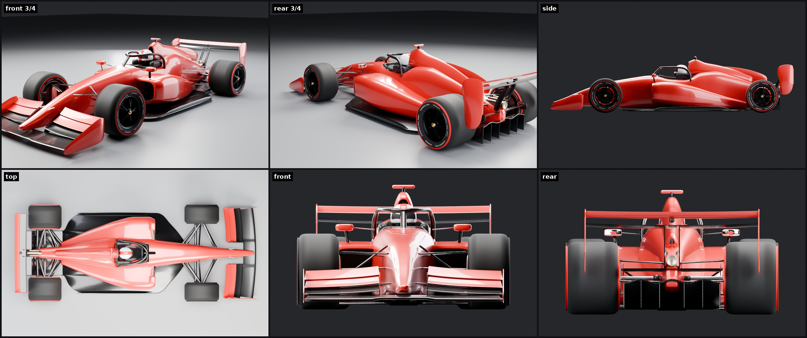
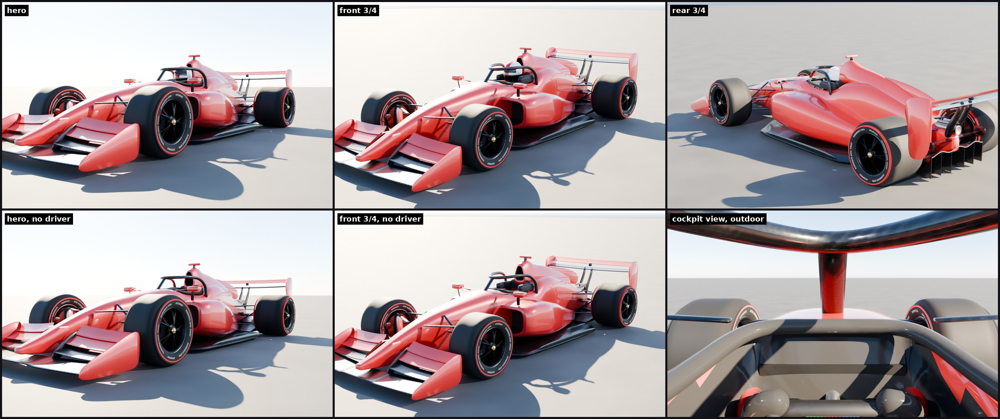
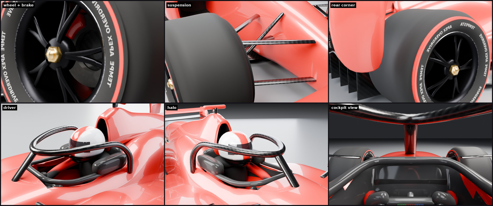
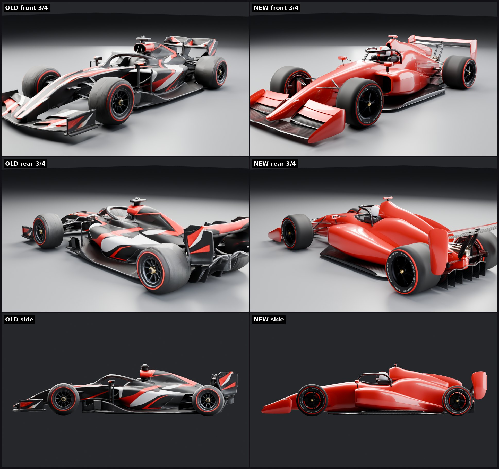
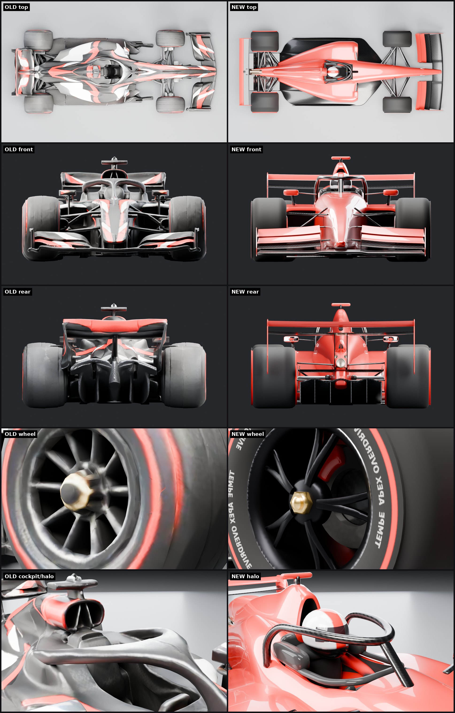
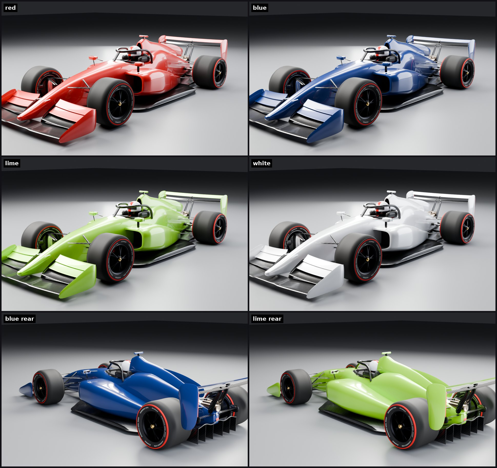
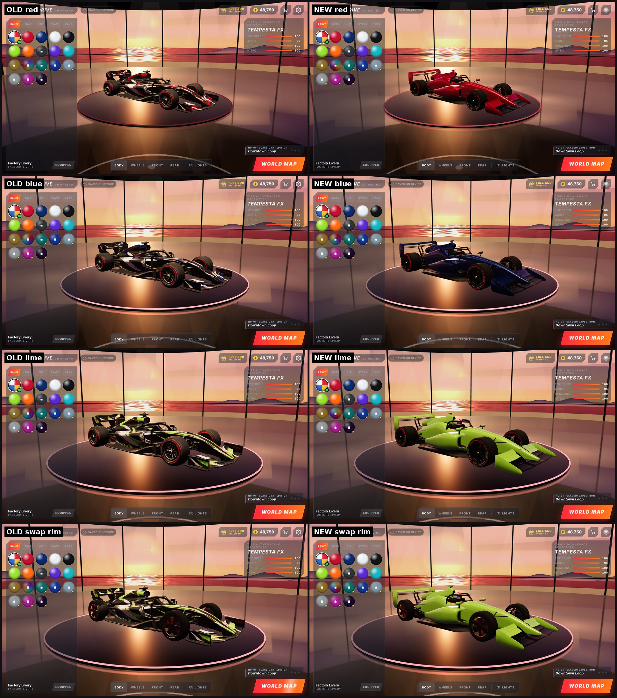
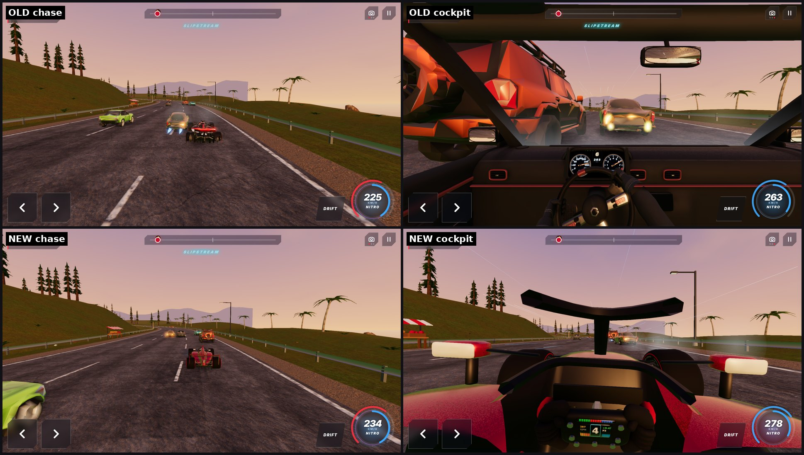
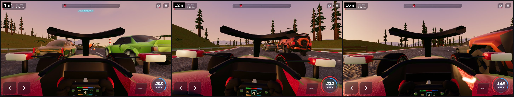
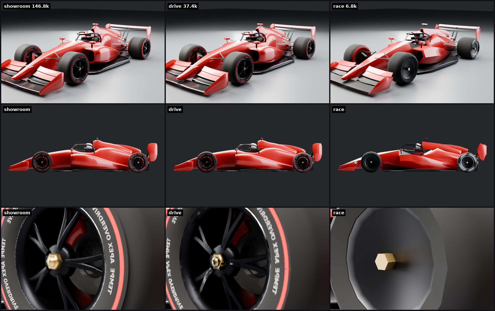

# পাইলট: নতুন Tempesta (Blender) — অনুমোদনের জন্য ছবি ও রিপোর্ট

**ব্রাঞ্চ:** [`pilot/tempesta`](https://github.com/imroulofficial/apex-overdrive-3d/tree/pilot/tempesta)। এর কোনো PR নেই, কোনো merge হয়নি, main এবং workflows ধরা হয়নি।
**গেম কোড:** `src/` এর কোনো পরিবর্তন commit করা হয়নি। গেমের ভেতরের স্ক্রিনশট নেওয়ার জন্য লোডারে একটা অস্থায়ী পরিবর্তন দরকার ছিল। সেটা শুধু লোকালি চালানো হয়েছে, তারপর ফেরত নেওয়া হয়েছে। সেই পরিবর্তনটা শুধু একটা ফাইল হিসেবে রাখা আছে: `tools/cars/preview-loader.patch`।
**ভিত্তি:** main v74। এখনো কিছুই গেমে যায়নি। নতুন ফাইলগুলো আছে শুধু `tools/cars/out/` এ।

---

## ১. সংক্ষেপে

- Tempesta (tm-tempesta, ৫.২০ মি ফর্মুলা কার) পুরোপুরি কোড থেকে নতুন করে বানানো হয়েছে। কোনো .blend ফাইল বা ডাউনলোড করা মেশ ব্যবহার হয়নি।
  - বডির আকার, অনুপাত আর সিলুয়েট আগের মতোই রাখা হয়েছে।
  - আগের মডেল আর New Car.zip শুধু রেফারেন্স হিসেবে দেখা হয়েছে। কোনো জ্যামিতি কপি করা হয়নি।
  - কোনো আসল কোম্পানির নাম, লোগো বা আকার নেই। টায়ারের গায়ে লেখা "APEX OVERDRIVE / TEMPESTA"।
- তিনটা LOD-ই বাজেটের ভেতরে। সবগুলোতে **open edge = 0**, অর্থাৎ কোনো ফাঁক বা ছিদ্র নেই।
- নোড কাঠামো চুক্তি মেনে বানানো:
  - চাকার নোডের origin ঠিক অক্ষের উপর।
  - টায়ার আর রিম আলাদা মেশ।
  - caliper আর brake disc আপরাইটের সাথে লাগানো, চাকার সাথে ঘোরে না।
  - `driver` আর `steering_wheel` আলাদা নোড।
  - তিনটা LOD-এই lens নোড আছে।
- নিজস্ব ককপিট: halo, ডিসপ্লে আর বোতামসহ ফর্মুলা স্টিয়ারিং, গ্লাভস পরা হাত, সাইডপডের উপর মিরর। জানালা নেই, তাই এই গাড়িতে জানালার বোতামও থাকবে না।
- গ্যারেজে রং বদলালে পরিষ্কার রং আসে। ফ্যাক্টরি পেইন্টের পুরনো দাগ বেক করা নেই। সোয়াপ রিমও ঠিকমতো বসে।

## ২. স্ট্যাটস (pack.mjs এর মাপ, `tools/cars/out/tm_tempesta-stats.json`)

| LOD | ফাইল | ত্রিভুজ / সীমা | সাইজ / সীমা | open edges | টেক্সচার |
|---|---|---|---|---|---|
| শোরুম | `tm_tempesta.glb` | **146,820** / 150,000 | **1,577 KB** / 1,758 KB (1.8 MB) | **0** | Body 2048² base + 1024² ORM + 1024² normal; Tyre 1024² ×3; Rim, Driver 512² ×3 (WebP) |
| ড্রাইভ | `tm_tempesta_drive.glb` | **37,356** / 40,000 | **457 KB** / 635 KB (0.65 MB) | **0** | Body 1024² base (AO মেশানো) + 512² normal; Tyre 512²; Rim, Driver 256² |
| রেস (রাইভাল) | `tm_tempesta_race.glb` | **6,794** / 8,000 | **119 KB** / 322 KB (0.33 MB) | **0** | টেক্সচার নেই: vertex colour = albedo × AO |
| ককপিট | `tm_tempesta_cockpit.glb` | 7,844 / 60,000 | 235 KB / 1.5 MB | 0 | 1024² base + 512² ORM + 512² normal |

তুলনার জন্য বর্তমান মডেল:

| LOD | ত্রিভুজ | সাইজ |
|---|---|---|
| শোরুম | 147,996 | 1,729 KB |
| ড্রাইভ | 39,997 | 612 KB |
| রেস | 8,205 | 306 KB |

নতুন মডেলে ত্রিভুজের সংখ্যা প্রায় একই, কিন্তু ফাইল ছোট। সবচেয়ে বড় পার্থক্য রেস LOD-এ: ১১৯ KB, আগে ছিল ৩০৬ KB।

**মাপ:**
- দৈর্ঘ্য ঠিক x ±২.৬০০ মি, অর্থাৎ ৫.২০ মি, cars.js এর সাথে মেলে।
- প্রস্থ (চাকা ধরে) z ±১.০৩৭।
- উচ্চতা ১.২১৬ মি।
- মাটি y = 0, নাক +X দিকে, উপরে +Y।
- Wheelbase ৩.৩৫০ মি: সামনের অক্ষ x = +১.৪২৫, পেছনের অক্ষ x = −১.৯২৫।
- Half-track: সামনে ০.৮৩২, পেছনে ০.৭৭২।

এই সব মান বর্তমান মডেল থেকে মেপে নেওয়া।

**ম্যাটেরিয়াল (৯টা):** `CarPaint` (শুধু রং বদলানো যায় এমন অংশ), `Body` (কার্বন, প্লাস্টিক, ধাতু), `Tyre`, `Rim`, `Glass` (ভাইজর আর মিরর), `Driver`, `headlight_lens`, `taillight_lens`, `exhaust`।

**চাকা** (সামনে আর পেছনের ব্যাসার্ধ আলাদা, দুটোই রেকর্ড করা হয়েছে, root node এর `extras.apex` এও আছে):

| | ব্যাসার্ধ | প্রস্থ | চারদিকের সেগমেন্ট | ক্রাউনে ভার্টেক্সের ব্যাসার্ধের পার্থক্য | ফ্যাসেটের গভীরতা |
|---|---|---|---|---|---|
| সামনে | **০.৩৭০ মি** | ০.৪০০ | শোরুম ৭২, ড্রাইভ ৩২, রেস ১৬ | ≤ ০.০৭ মিমি | ০.৩৫ / ১.৮ / ৭.১ মিমি |
| পেছনে | **০.৩৫৫ মি** | ০.৫২০ | শোরুম ৭২, ড্রাইভ ৩২, রেস ১৬ | ≤ ০.০৭ মিমি | ০.৩৪ / ১.৭ / ৬.৮ মিমি |

টায়ার একটা প্রোফাইলকে ঘুরিয়ে (revolve) বানানো। তাই প্রতিটা ভার্টেক্স একই বৃত্তের উপর পড়ে, অর্থাৎ চাকা পুরোপুরি গোল। চাকার উপরে আর নিচে একটা করে ভার্টেক্স থাকে, তাই bbox থেকে পড়া ব্যাসার্ধও সঠিক আসে। আগের পদ্ধতিতে (stats.json এর `roundness`, tread বরাবর min/max) মাপ ০.৯৯৪–০.৯৯৮।

## ৩. Cycles রেন্ডার: নতুন মডেল

স্টুডিও আলো, ৬টা দিক থেকে (সামনে ৩/৪, পেছনে ৩/৪, পাশ, উপর, সামনে, পেছনে):



বাইরের আলো (আকাশ আর সূর্য), ড্রাইভারসহ:



ক্লোজ-আপ: চাকা আর ব্রেক, সাসপেনশন, পেছনের কোণ, ড্রাইভার, halo, ককপিট ভিউ:



## ৪. পুরনো বনাম নতুন (একই কোণ থেকে)




রং (লাল, নীল, লাইম, সাদা), Cycles রেন্ডারে:



## ৫. গেমের ভেতরে (অস্থায়ী লোডার দিয়ে, commit করা হয়নি)

গ্যারেজ, বাঁয়ে পুরনো আর ডানে নতুন। সারিগুলো: লাল, নীল, লাইম, তারপর লাল রঙে সোয়াপ রিম (monoblock):



রেস, Emerald Coast স্টেজ ১, autopilot, ৮ সেকেন্ডে নেওয়া। উপরের সারি পুরনো, নিচের সারি নতুন। বাঁয়ে চেজ ক্যামেরা, ডানে ককপিট (ড্রাইভার ভিউ):



নতুন গাড়ির ককপিট ভিউ, তিনটা আলাদা মুহূর্তে (৪, ১২, ১৬ সেকেন্ড):



পুরনো গাড়িতে ককপিট ভিউ চাপলে এখন সব গাড়ির জন্য একই সেডান কেবিন দেখায়। নতুন গাড়ি নিজের খোলা ফর্মুলা ককপিট দেখায়: halo, স্টিয়ারিং ডিসপ্লে, হাত আর মিরর।

## ৬. LOD তুলনা (শোরুম, ড্রাইভ, রেস; একই কোণ থেকে)



## ৭. কীভাবে বানানো হয়েছে

পুরো পদ্ধতি নতুন ৭টা গাড়ির জন্য আবার ব্যবহার করা যাবে। বিস্তারিত আছে `tools/cars/README.md` এ।

1. **`tools/cars/meshkit.py`**: watertight (ফাঁকহীন) প্রিমিটিভের লাইব্রেরি।
   - loft, sweep, revolve, strut, slab, airfoil/wing, blob, patch-slab।
   - প্রতিটা প্রিমিটিভ বন্ধ মেশ ফেরত দেয়।
   - `open_edges()` ভার্টেক্স জোড়া দিয়ে ফাঁক গোনে।
2. **`tools/cars/defs/tm_tempesta.py`**: Tempesta এর ডিজাইন, পুরোটা bpy/Python এ।
   - কার্ভ দিয়ে বানানো অংশ: চেসিস (নাক থেকে লেজ এক টুকরো), সাইডপড আর ইনলেট, এয়ারবক্স, halo, মিরর, ফ্লোর, ডিফিউজার।
   - সামনের উইং: ৩টা ফ্ল্যাপ আর এন্ডপ্লেট।
   - পেছনের উইং: বিম উইং, DRS পড, rain light।
   - সামনের LED, এক্সহস্ট, উইশবোন, পুশ/পুলরড।
   - টায়ার: সাইডওয়ালে লেখাসহ।
   - রিম: ১০টা Y-স্পোক।
   - আপরাইট, ডিস্ক আর ক্যালিপার।
   - ড্রাইভার: হেলমেট, ভাইজর, HANS, স্যুট, গ্লাভস।
   - স্টিয়ারিং: ডিসপ্লে আর বোতামসহ।
3. **`tools/cars/build_car.py`**: একই ডিজাইনকে বিভিন্ন detail level এ নমুনা নিয়ে বানায়: শোরুম q = 1.0, ড্রাইভ 0.43, রেস 0.075।
   - LOD বানানো হয় কম সেগমেন্ট নিয়ে, decimation দিয়ে নয়। তাই প্রতিটা LOD ফাঁকহীন থাকে।
   - তারপর UV করে Cycles দিয়ে বেক করে: base, AO, roughness, metal, normal।
   - শোরুমে AO, roughness আর metal মিলে একটা ORM টেক্সচার হয়।
   - ড্রাইভে AO সরাসরি base রঙে গুণ করা থাকে।
   - রেসে albedo × AO vertex colour এ রাখা হয়, কারণ গেমের রাইভাল atlas batching সেটাই আশা করে।
   - শেষে নোড ভাগ হয়: চাকা, caliper আর disc আপরাইটে, বাঁ পাশ ডান পাশের আয়না-কপি।
4. **`tools/cars/pack.mjs`**: WebP টেক্সচার আর meshopt কম্প্রেশন। তারপর বাজেট, open edge, চাকার গোলত্ব আর bbox মাপে।
5. **`tools/cars/render.py`**: Cycles রেন্ডার (স্টুডিও/বাইরে, রং বদল, ককপিট)।
6. **`tools/cars/preview.mjs`**: Playwright দিয়ে গেমের ভেতরের গ্যারেজ আর রেসের স্ক্রিনশট। এর জন্য অস্থায়ী patch লাগে।

কমান্ড:
```
python tools/cars/build_car.py --car tm_tempesta
node tools/cars/pack.mjs tm_tempesta
```
বেকসহ পুরো বিল্ড প্রায় ২০ মিনিট লাগে।

## ৮. দুর্বল দিক (সৎভাবে বলছি)

- **রিম:** স্পোক একটু পাতলা আর রিম সামগ্রিকভাবে গাঢ়। গেমের গ্যারেজে দূর থেকে রিমের ডিটেইল কম বোঝা যায়। পরের ধাপে স্পোক মোটা আর রিম একটু উজ্জ্বল করা যায়।
- **ককপিট ভিউ:**
  - ড্রাইভ LOD-এ halo একটু কোণাচে দেখায়, কারণ ড্রাইভারের চোখের খুব কাছে থাকে।
  - সাইডপডের মিরর হাউজিং ড্রাইভার ভিউতে একটু বড় লাগে।
  - দুটোই ডিজাইন ফাইলের ছোট পরিবর্তনে ঠিক করা যায়।
- **ফ্যাক্টরি রং:** কোনো livery টেক্সচার না থাকলে গেম 'factory' রঙে swatch #d9dde3 (হালকা ধূসর) দেখায়। এটা গেমের নিয়ম। প্রতিটা গাড়ির নিজস্ব ফ্যাক্টরি রং দিতে লোডারে ছোট পরিবর্তন লাগবে (নিচের তালিকা দেখুন)।
- **বর্তমান লোডার এখনো নতুন নোড কাঠামো পুরোপুরি ব্যবহার করে না। গেমে যাওয়ার আগে কোড বদলাতে হবে:**
  - পেছনের চাকাও সামনের চাকার ব্যাসার্ধে (০.৩৭০) ঘোরে।
  - আপরাইট আর caliper স্টিয়ারিংয়ের সাথে ঘোরে না।
  - বাইরের মডেলে হাত স্টিয়ারিংয়ের সাথে ঘোরে না।
- **Cycles এর ককপিট রেন্ডার:** ক্যামেরা একটু নিচু, তাই স্টিয়ারিং ডিসপ্লে ফ্রেমের নিচে কাটা পড়ে। আসল ড্রাইভার ভিউ কেমন দেখায়, তা গেমের ভেতরের স্ক্রিনশটে (অংশ ৫) ঠিকমতো দেখা যায়।
- **রেস LOD:** রিম একটা সমতল চাকতি, টায়ারে লেখা নেই। এই LOD শুধু দূরের রাইভালদের জন্য, ৮k ত্রিভুজের বাজেটে রাখতে এটা ইচ্ছা করে করা।
- **UV আর টেক্সচার:** Smart UV seam আছে। 2048² এ কার্বন weave এর texel ঘনত্ব সীমিত, কাছ থেকে দেখলে নরম লাগে।
- **ছোটখাটো:** ককপিটের সামনের কোণে খুব ছোট ভাঁজ থাকতে পারে। হেলমেটের livery সাধারণ।
- **রেন্ডারের মান:** ২৮ sample এ রেন্ডার করা, তাই কিছু ছবিতে হালকা noise আছে। গেমের মানের সাথে এর সম্পর্ক নেই।

## ৯. পরে গেম কোডে যা লাগবে (এখন করা হয়নি)

1. **চাকার pivot:** wheel নোডের origin থেকে নিতে হবে, bbox centre থেকে নয় (`modelLoader.js` এর wheel rig)।
2. **প্রতি অক্ষে আলাদা চাকার ব্যাসার্ধ:** এখন শুধু FR থেকে `wheelRadius` নেওয়া হয়। `extras.apex.wheelRadius.front/rear` পড়ে পেছনের চাকার spin আলাদা করতে হবে।
3. **caliper, brake disc আর আপরাইট:** wheel rig এর steer গ্রুপে রাখতে হবে, spin গ্রুপের বাইরে। সামনের আপরাইট steer করবে।
4. **ককপিট ভিউ:**
   - `driver` আর `steering_wheel` লুকাতে হবে।
   - গাড়ির নিজস্ব `_cockpit.glb` লোড করতে হবে।
   - চোখের অবস্থান `extras.apex.eye` থেকে নিতে হবে।
   - shared সেডান কেবিন বন্ধ রাখতে হবে।
   - `windows: false` হলে জানালার বোতাম লুকাতে হবে।
5. **steering_wheel:** নোডের pivot অক্ষের উপর। ইনপুট অনুযায়ী ঘোরাতে হবে (axis local +x, tilt ১৮°)।
6. **Lens নাম:** `headlight_lens` আর `taillight_lens` নোড/ম্যাটেরিয়াল লোডারের লাইট প্যাটার্নে যোগ করতে হবে। rain light ব্রেক আর রাতের আলো হিসেবে কাজ করবে।
7. **প্রতি গাড়ির ফ্যাক্টরি রং:** livery না থাকলে #d9dde3 না দেখিয়ে cars.js এ গাড়ির নিজস্ব রং।
8. **cars.js এ model URL:** নতুন ফাইলগুলো `public/assets/models/` এ কপি করতে হবে। নাম একই রাখলে কোডে কোনো পরিবর্তন লাগবে না।

অস্থায়ী preview patch (`tools/cars/preview-loader.patch`) ১, ৪ আর আংশিক ২ এর একটা কাজ চালানোর মতো নমুনা। সেটা প্রোডাকশন কোড নয়।

## ১০. ফাইল

- মডেল: `tools/cars/out/tm_tempesta.glb`, `_drive.glb`, `_race.glb`, `_cockpit.glb`, আর `tm_tempesta-stats.json`
- সব ছবি: `docs/pilot-tempesta/` (সব রেন্ডার আর স্ক্রিনশট, তুলনার শিট)

অনুমোদন পেলে এই পদ্ধতিতে বাকি ৭টা গাড়ি বানানো হবে। তারপর উপরের কোড পরিবর্তনগুলো আলাদা একটা PR এ করা হবে।
