# পাইলট Tempesta — রিভিশন ২ (শুধু অনুমোদনের জন্য ছবি)

**ব্রাঞ্চ:** [`pilot/tempesta`](https://github.com/imroulofficial/apex-overdrive-3d/tree/pilot/tempesta)। কোনো PR খোলা হয়নি, কোনো merge হয়নি। main আর workflows ছোঁয়া হয়নি।
**গেম কোড:** `src/` এর কোনো পরিবর্তন commit করা হয়নি। গেমের ভেতরের স্ক্রিনশট নিতে অস্থায়ী লোডার patch শুধু লোকালি চালানো হয়েছিল, তারপর `git checkout src` দিয়ে ফেরত নেওয়া হয়েছে। patch টা শুধু ফাইল হিসেবে রাখা আছে: `tools/cars/preview-loader.patch` (এবার লাইভ মিররের অংশও এতে আছে)।
**আগের রিপোর্ট:** রিভিশন ১ এর রিপোর্ট `PILOT-TEMPESTA-BN.md` আর ছবি `docs/pilot-tempesta/` এ অপরিবর্তিত আছে।

---

## ১. সংক্ষেপে কী বদলেছে

- **লিভারি আর ম্যাটেরিয়াল:** কালো/কার্বন বেস, তার উপর লাল পেইন্ট জোন আর সাদা অ্যাকসেন্ট। পুরোটা নিজস্ব ডিজাইন, কোনো আসল টিম বা স্পনসর নেই। লেখা শুধু সাধারণ: রেস নম্বর **17**, **APEX OVERDRIVE**, **TEMPESTA**।
  - সারফেস এখন ৫ ভাগে: CarPaint জোন, খোলা কার্বন (ফ্লোর, উইংয়ের এলিমেন্ট, halo, সাসপেনশন, সাইডপডের নিচের কাট, ককপিটের চারপাশ), satin কালো, সাদা অ্যাকসেন্ট, ধাতু।
  - কার্বনে আসল twill weave দেখা যায় (আলাদা টাইলিং টেক্সচার)। gloss কার্বন আর satin কালোর মধ্যে স্পষ্ট পার্থক্য।
  - পেইন্টে clear-coat।
  - প্যানেল লাইন, নাকে নম্বর, সাইডপড আর পেছনের উইংয়ে লেখা।
- **রং বদলালে পরিষ্কার রং:** পেইন্ট ম্যাপে শুধু শেড আছে (AO, প্যানেল লাইন, কালো লেখা)। গেমের বিদ্যমান `liveryPaint` নিয়ম (texel luminance / factoryLum) দিয়েই প্লেয়ারের রং বসে, কোনো দাগ বেক করা নেই। "Factory Livery" বাছলে কারখানার লাল লিভারি দেখায়। এবার ধূসর #d9dde3 আসে না।
- **অ্যারো আরও ধারালো:**
  - সাইডপড পাতলা, ধারালো কিনারা আর গভীর undercut।
  - ইঞ্জিন কভার সরু, উঁচু shark fin।
  - নাক আর চেসিসে পরিষ্কার কিনারা।
  - সামনের উইং: ৪ এলিমেন্ট, এন্ডপ্লেটে কাট-আউট, ফুটপ্লেট, dive plane, নিচে ফেন্স।
  - বার্জবোর্ড / টার্নিং ভেন (৩টা ভেন আর একটা boomerang, দুই পাশে)।
  - ফ্লোরের কিনারায় strake, ফেন্স আর edge wing।
  - সামনে ব্রেক ডাক্ট, পেছনে ছোট winglet।
  - পেছনের উইং: এন্ডপ্লেটে ৫টা louvre আর সামনে খাঁজ, ২ এলিমেন্টের beam wing।
  - ডিফিউজার: ৯টা ফেন্স আর gurney।
  - সাইডপড ইনলেট ভেতরে ০.৩০ মি গভীর।
- **রিম:** gunmetal রঙ, পালিশ করা lip, lip এ পেইন্টের রিং (রং বদলালে রিংও বদলায়), ১০টা মোটা বাঁকানো স্পোক, ৬ কোণা নাট, ৬টা পিন। ভেতরে ড্রিল করা ডিস্ক আর উজ্জ্বল ক্যালিপার দেখা যায়।
- **ককপিট ভিউ:**
  - halo পাতলা আর কার্বন। সামনের অংশ নিচু (০.৯০৫ মি), তাই উপরের দিক খোলা। মাঝের pillar রাস্তা ঢাকে না।
  - চোখের অবস্থান অনবোর্ড ক্যামেরার মতো (x −০.৩০, y ১.০২)।
  - সাইডপডে ছোট মিরর, কাচে লাইভ রিফ্লেকশন (mid/high tier) বা আকাশের gradient (low-end)। সাদা ব্লক আর নেই।
  - হেডরেস্টে প্যাড, কার্বন রিম।
  - সামনের দুই টায়ার দেখা যায়।
  - ফর্মুলা স্টিয়ারিং ডিসপ্লে, বোতাম আর গ্লাভস পরা হাত রাখা হয়েছে।
- **রাখা হয়েছে:** নোডের নাম আর চুক্তি, open edges = 0, গোল চাকা, বাজেট, রং বদল, সোয়াপ রিম, FX, লাইট, গ্যারেজ।

## ২. স্ট্যাটস (`tools/cars/out/tm_tempesta-stats.json`)

| LOD | ফাইল | ত্রিভুজ / সীমা | সাইজ / সীমা | open edges | রিভিশন ১ |
|---|---|---|---|---|---|
| শোরুম | `tm_tempesta.glb` | **136,928** / 150,000 | **1,640 KB** / 1,758 KB (1.8 MB) | **0** | 146,820 · 1,577 KB |
| ড্রাইভ | `tm_tempesta_drive.glb` | **38,972** / 40,000 | **604 KB** / 635 KB (0.65 MB) | **0** | 37,356 · 457 KB |
| রেস (রাইভাল) | `tm_tempesta_race.glb` | **7,574** / 8,000 | **104 KB** / 322 KB (0.33 MB) | **0** | 6,794 · 119 KB |
| ককপিট | `tm_tempesta_cockpit.glb` | 7,844 / 60,000 | 288 KB / 1.5 MB | 0 | 7,844 · 235 KB |

- **চাকা:** সামনে ব্যাসার্ধ ০.৩৭০ মি, পেছনে ০.৩৫৫ মি। গোলত্ব (tread এর min/max) শোরুম ০.৯৯৬, ড্রাইভ ০.৯৯৮, রেস ০.৯৯৭।
- **ম্যাটেরিয়াল (১১টা):** CarPaint, Body, Carbon (নতুন), MirrorGlass (নতুন), Tyre, Rim, Glass, Driver, headlight_lens, taillight_lens, exhaust।
- **শোরুম টেক্সচার (WebP):** Body 2048² base + 1024² ORM + 1024² normal; CarPaint 1024²; Carbon weave 512² (টাইলিং) + 512² ORM; Tyre 1024²; Rim আর Driver 512²।
- **ড্রাইভ টেক্সচার:** Body 1024² + 512² normal; CarPaint 512²; Carbon weave + 512² ORM; বাকিগুলো 256–512²।

## ৩. স্টুডিও রেন্ডার, ৬ দিক থেকে (Cycles)

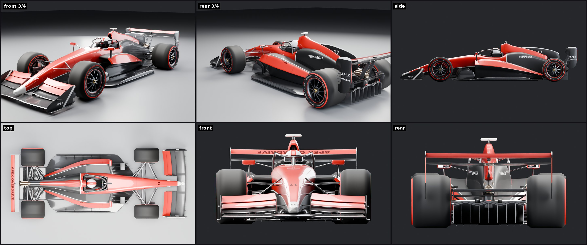

## ৪. বাইরের আলো

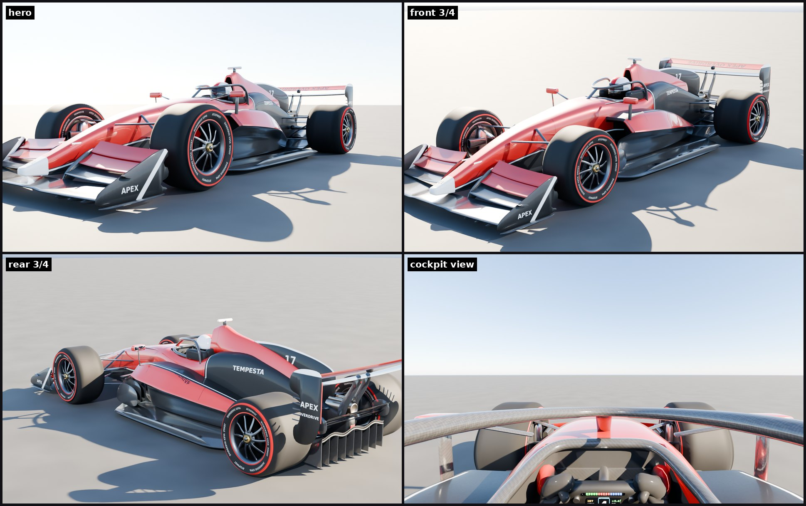

## ৫. ক্লোজ-আপ

চাকা আর ব্রেক, সামনের সাসপেনশন, পেছনের কোণ, ড্রাইভার, halo, ককপিট ভিউ:

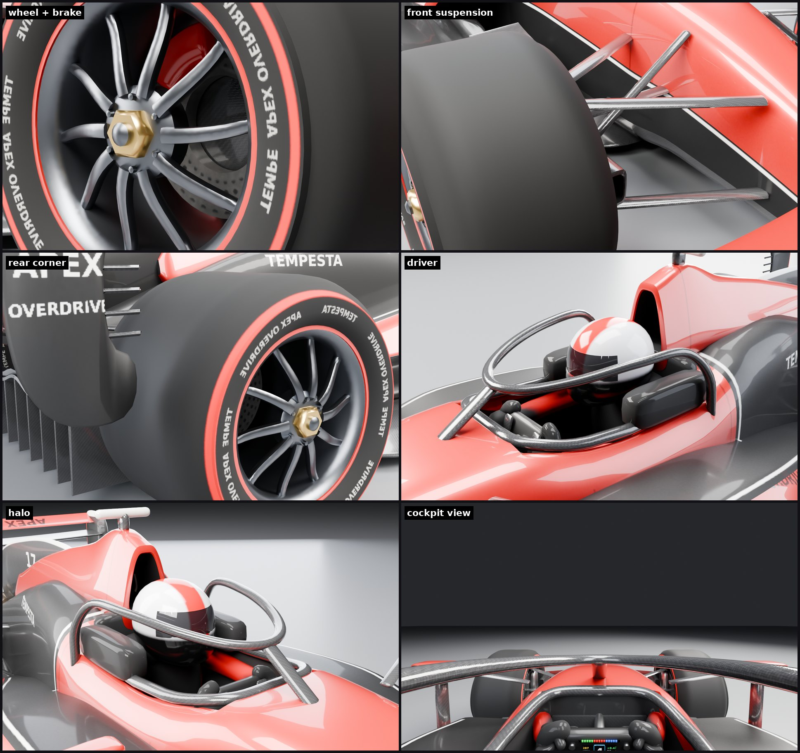

অ্যারো: বার্জবোর্ড আর ফ্লোর, সাইডপডের undercut, সামনের উইং, পেছনের উইং আর beam wing, ডিফিউজার:

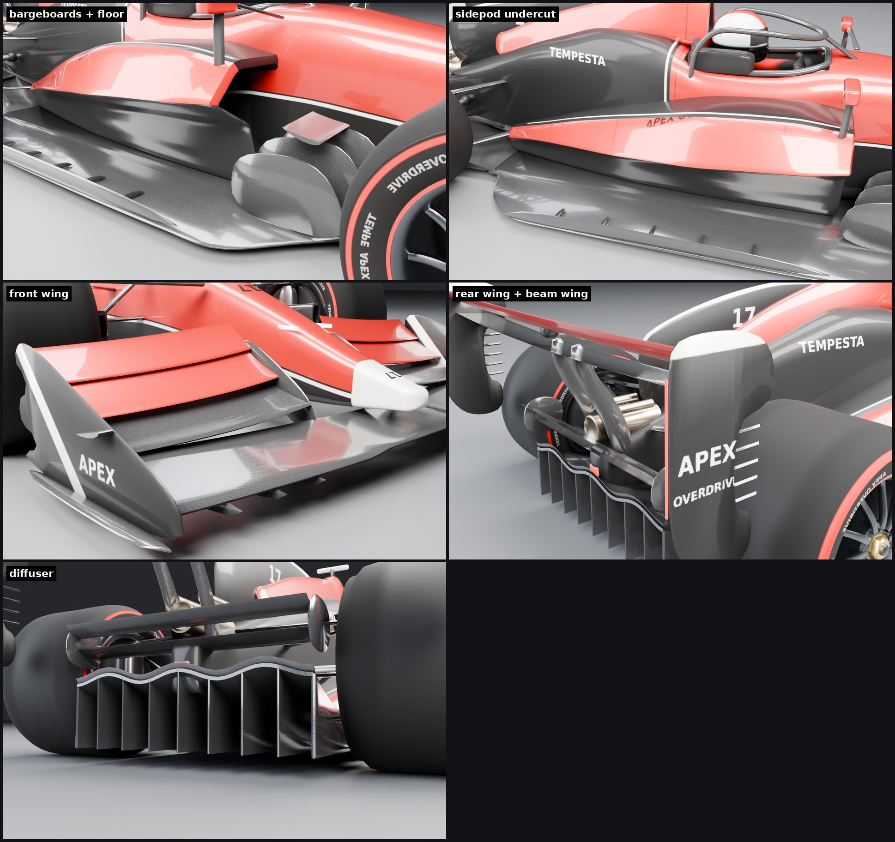

## ৬. পুরনো বনাম রিভিশন ১ বনাম রিভিশন ২ (একই কোণ থেকে)

প্রতিটা সারিতে বাঁয়ে পুরনো মডেল, মাঝে রিভিশন ১, ডানে রিভিশন ২:

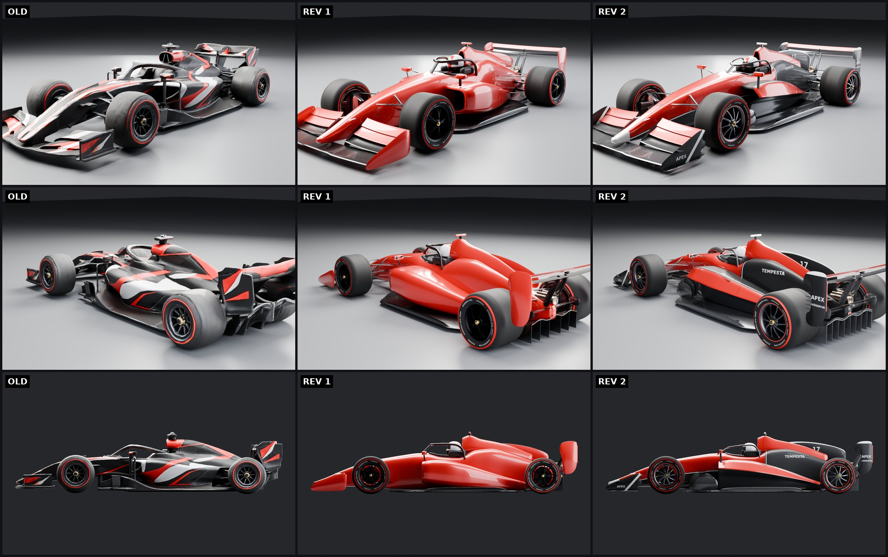
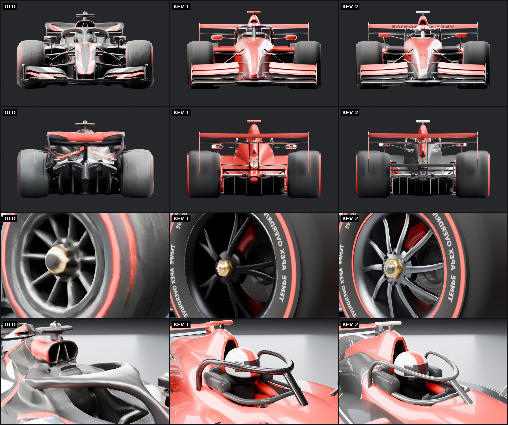

ককপিট ভিউ, রিভিশন ১ বনাম রিভিশন ২ (উপরে Cycles, নিচে গেমের ভেতরে):

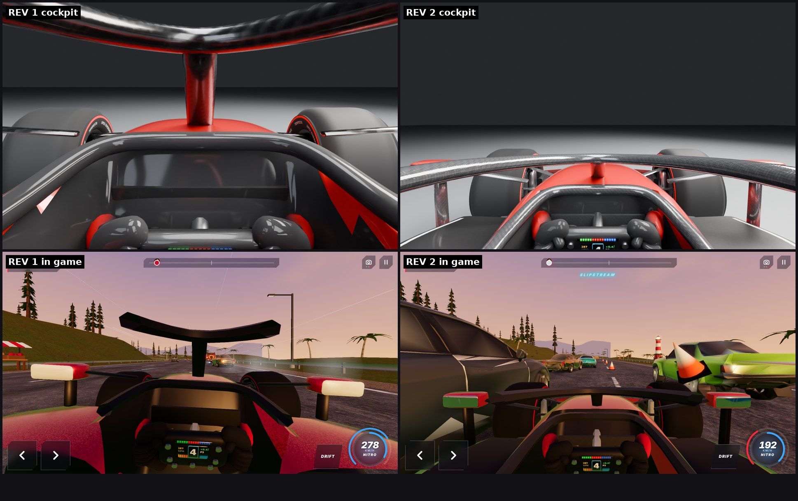

## ৭. রং আর LOD

ফ্যাক্টরি লাল, নীল, লাইম, সাদা (Cycles; রং বদলের নিয়ম গেমের মতোই):

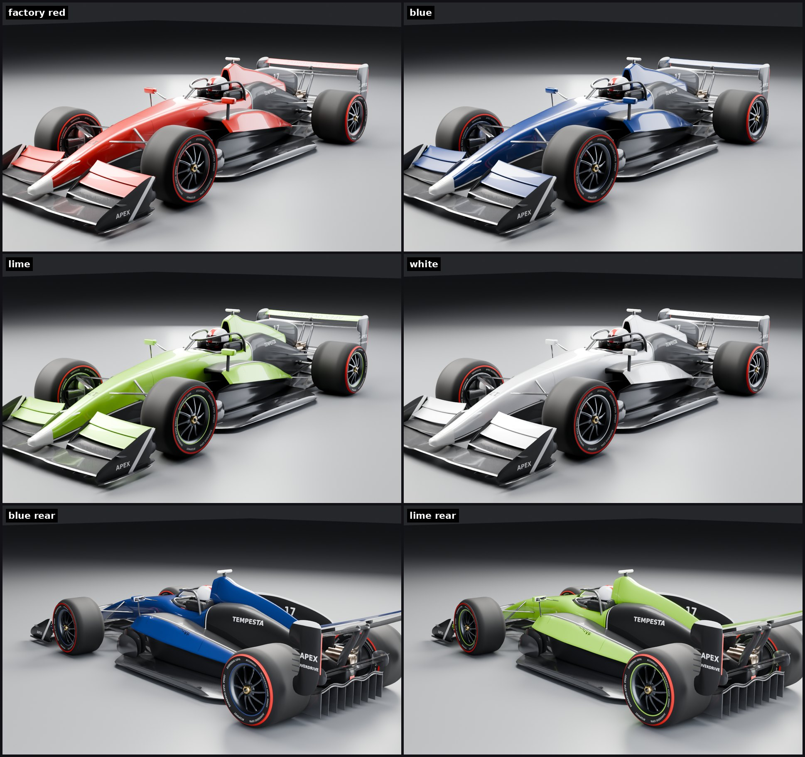

LOD তুলনা (শোরুম, ড্রাইভ, রেস):

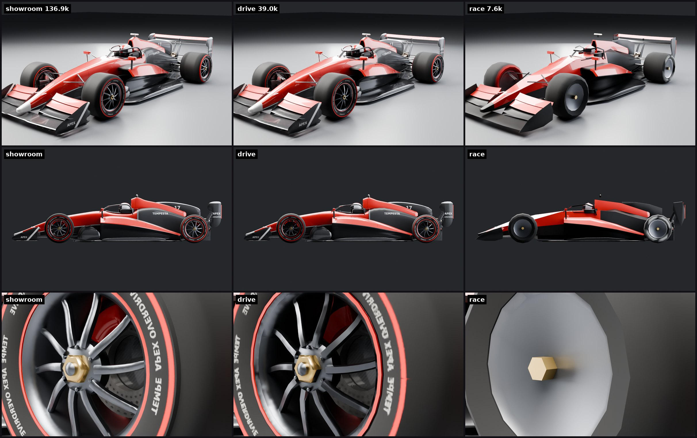

## ৮. গেমের ভেতরে (অস্থায়ী লোডার, commit করা হয়নি)

গ্যারেজ: বাঁয়ে পুরনো, ডানে রিভিশন ২। সারিগুলো: Factory Livery, লাল, নীল, তারপর লাইম রঙে সোয়াপ রিম (monoblock):

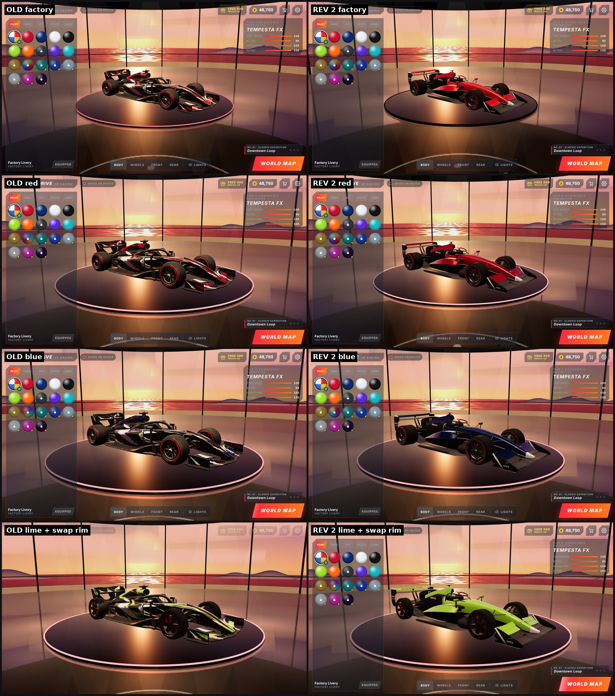

দিন (Emerald Coast স্টেজ ১), autopilot। উপরে চেজ ক্যামেরা, নিচে ককপিট। বাঁয়ে সোজা রাস্তা, ডানে বাঁক নেওয়ার মুহূর্ত (heading > ০.২৫ rad/s):

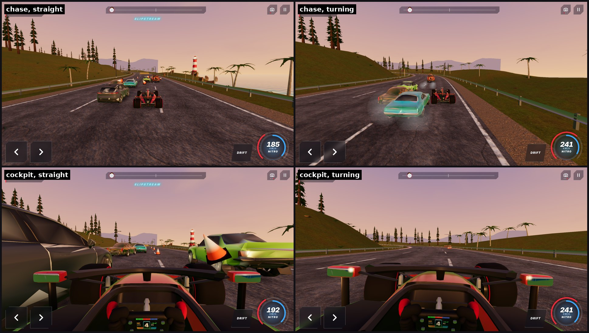

রাত (Neon City স্টেজ ১), একই সাজানো:

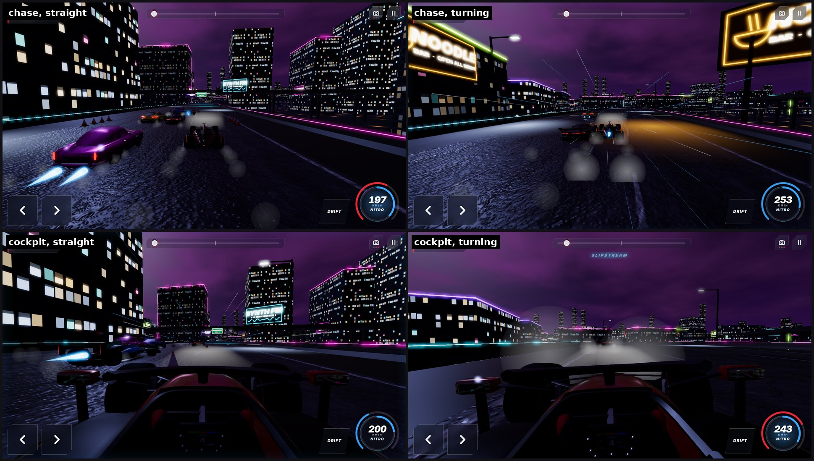

পুরনো বনাম রিভিশন ২, গেমের ভেতরে:

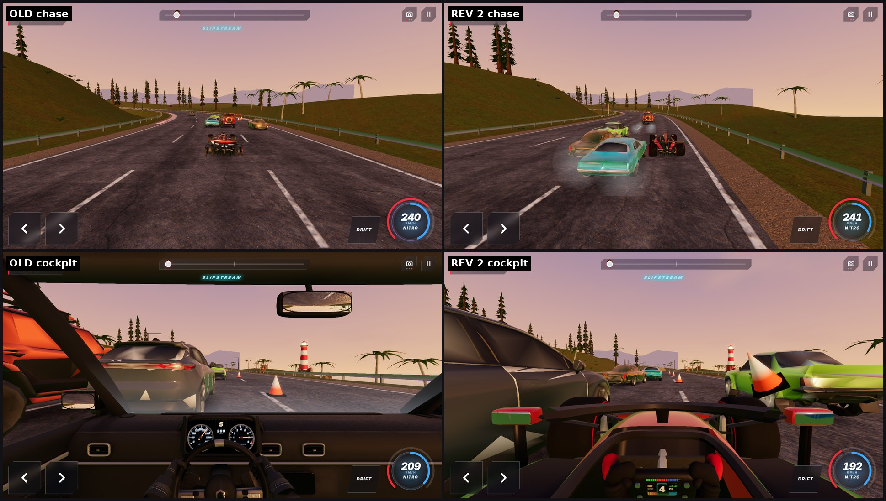

সব আলাদা ছবি পূর্ণ রেজোলিউশনে আছে `docs/pilot-tempesta-r2/full/` এ।

## ৯. পাইপলাইনের উন্নতি (বাকি ৭টা গাড়িও এগুলো পাবে)

1. **`tools/cars/livery.py` (নতুন):** লিভারি আঁকার সাধারণ টুল। বেক করা প্রতিটা texel এর গাড়ির-ফ্রেমে অবস্থান আর normal দিয়ে numpy তে আঁকা হয়:
   - `stamp`: লেখা বা নম্বর সারফেসে প্রজেক্ট করে।
   - `text_mask`, `number_mask`: লেখা আর outline সহ নম্বর।
   - `band`, `line`, `box`, `both_sides`: স্ট্রাইপ আর প্যানেল লাইন।
   - রেজোলিউশন থেকে স্বাধীন, তাই একই ফাংশন 2048 আর 512 দুই atlas এই কাজ করে।
2. **`build_car.py`:**
   - অবস্থান আর normal বেক (emission দিয়ে, float ইমেজে)।
   - প্রতিটা ডিজাইনের `livery(group, P, N, valid)` ফাংশন। CarPaint এ শুধু শেড যায়, Body তে রং আর roughness এর লেয়ার।
   - আলাদা **Carbon** ম্যাটেরিয়াল: টাইলিং twill weave (albedo আর normal, দ্বিতীয় UV তে, মিটার অনুযায়ী box projection), সাথে বেক করা AO আর roughness।
   - ম্যাটেরিয়াল কী: `carbon`, `carbon:satin`, `body:white`, `body:gloss`, `body:satin`, `mirror`, ড্রিল করা ডিস্ক, gunmetal রিম, `rim:spoke`।
   - MirrorGlass এর জন্য প্রতি কাচে ০..১ planar UV, যাতে লাইভ মিরর টেক্সচার সরাসরি বসে।
3. **`meshkit.py`:** `fillet_poly`: গোল কোণাসহ সেকশন, ভার্টেক্সের সংখ্যা নির্দিষ্ট, প্রতি কোণার মাঝের index ফেরত দেয়। এতে পেইন্ট/কালো/কার্বনের সীমানা ঠিক ভার্টেক্স সারিতে পড়ে, ফলে লাইন পরিষ্কার।
4. **`pack.mjs`:**
   - CarPaint ম্যাপ আর `factoryLum` extras এ।
   - Carbon এর weave texCoord 1 এ।
   - weave UV কে ০..১ এ এনে `KHR_texture_transform` দিয়ে স্কেল ফেরত। এতে UV 16-bit এ কম্প্রেস হয় (আগে float থেকে যেত)। three.js এটা নিজেই সমর্থন করে।
   - meshopt এর লেভেল `high`। এতে শোরুম ২,১১৩ থেকে ১,৬৪০ KB আর ড্রাইভ ৭৩৮ থেকে ৬০৪ KB তে নেমেছে।
   - গেমে কার্বনের roughness একটু তোলা হয় (নিচে দুর্বল দিক দেখুন)।
5. **`render.py`:** নতুন ভিউ (aero, sidepod, front_wing, rear_wing, diffuser)। ককপিট ভিউ এখন গেমের ক্যামেরার নিয়মে (চোখ ডিজাইন ফাইল থেকে, ৭০° vertical FOV, ৩০ মি সামনে দেখে)।
6. **`preview.mjs`:** গ্যারেজ (৪ রং আর সোয়াপ রিম), রেস দিন/রাত × চেজ/ককপিট × সোজা/বাঁক, স্বয়ংক্রিয়ভাবে।

কমান্ড আগের মতোই (`tools/cars/README.md`):
```
python tools/cars/build_car.py --car tm_tempesta     # বেকসহ ~২০ মিনিট
node tools/cars/pack.mjs tm_tempesta
```

## ১০. দুর্বল দিক (সৎভাবে)

- **ড্রাইভ LOD এর বাজেট টাইট:** ৩৮,৯৭২ / ৪০,০০০ ত্রিভুজ। বাকি গাড়িতে আরও ডিটেইল যোগ করলে কোথাও থেকে কমাতে হবে।
- **শোরুমে কার্বনের ORM 512²:** 1.8 MB এর মধ্যে রাখতে 1024² থেকে নামানো হয়েছে। weave টেক্সচার আলাদা আর টাইলিং, তাই weave এর ধার কমেনি, শুধু বেক করা AO একটু নরম।
- **গেমে কার্বন একটু কম চকচকে:** Cycles এ কার্বনে clear-coat আছে। গেমের সাধারণ ম্যাটেরিয়ালে সেটা নেই, তাই বেক করা roughness (~০.১১) গেমে আয়নার মতো হয়ে রাস্তার পাশের সবুজ ঘাস প্রতিফলিত করছিল। pack এ roughness ~০.৩১ এ তোলা হয়েছে। ফলে গেমে কার্বন Cycles এর চেয়ে একটু মলিন।
- **ককপিটের কিনারায় হালকা সবুজ আভা:** দিনের ককপিট ভিউতে নিচের দুই কোণে কার্বনের কিনারায় এখনো একটু পরিবেশের প্রতিফলন দেখা যায়।
- **ডিফিউজার ফেন্সে ঝিলিক:** চেজ ক্যামেরা থেকে দূরে ডিফিউজারের পাতলা ফেন্সে কয়েকটা উজ্জ্বল পিক্সেল ঝিকমিক করে (specular aliasing)। পরের রিভিশনে ফেন্স satin করলে কমবে।
- **ককপিট থেকে সামনের উইং দেখা যায় না:** চোখের উচ্চতায় নাক উইংকে ঢেকে দেয়। আসল অনবোর্ড ক্যামেরাতেও প্রায় এমনই হয়। সামনের দুই টায়ার পরিষ্কার দেখা যায়। উইং দেখাতে চাইলে চোখ আরও উঁচু করতে হবে, তখন halo রাস্তার উপর আসবে।
- **মিরর:** স্ক্রিনের দুই কিনারায় মিরর এখনো বেশ বড় দেখায়। মাপ আসল কাছাকাছি, কিন্তু চোখের খুব কাছে, তাই বড় লাগে। লাইভ কাচ শুধু অস্থায়ী patch এ কাজ করে, গেমে কোড লাগবে (নিচে দেখুন)।
- **লেখা:** সাইডপডের "APEX OVERDRIVE" এর একটা অংশ crest এর নিচে আংশিক ঢাকা পড়ে। পেছনের এন্ডপ্লেটে "OVERDRIVE" এর শেষ অক্ষর louvre এ কাটা পড়ে। টায়ারের লেখা রিভিশন ১ এর মতোই।
- **meshopt `high`:** অবস্থান আর normal আরও বেশি quantize হয়। ছবিতে কোনো ফাটল বা ভুল shading চোখে পড়েনি। open edge গোনা হয় কম্প্রেশনের আগে।
- **ড্রাইভ LOD এ weave:** চেজ ক্যামেরার দূরত্বে weave প্রায় পিক্সেলের চেয়ে ছোট, তাই রেসে কার্বন মূলত গাঢ় চকচকে কালো দেখায়। গ্যারেজে weave পরিষ্কার দেখা যায়।
- **চেজ ক্যামেরা:** গেমের চেজ ক্যামেরা গাড়ি থেকে বেশ দূরে, তাই রেসের ছবিতে গাড়ি ছোট। এটা পুরনো গাড়ির সাথেও একই, ক্যামেরা বদলানো হয়নি।
- **হেলমেট আর ড্রাইভার:** সাধারণ লিভারি, বেশি ডিটেইল নেই।
- **রেন্ডারের মান:** ২৮ sample, তাই কিছু ছবিতে হালকা noise।

## ১১. গেমে নেওয়ার আগে কোডে যা লাগবে (এখন কিছুই করা হয়নি)

ইতিমধ্যে কাজ করে, কোড লাগবে না:
- **ফ্যাক্টরি লিভারি আর রং বদল:** CarPaint ম্যাপ আর `factoryLum` বিদ্যমান `liveryPaint` দিয়েই চলে।
- **Carbon weave:** `KHR_texture_transform` আর দ্বিতীয় UV three.js নিজেই পড়ে।

কোড লাগবে:
1. **লাইভ মিরর:** `MirrorGlass` ম্যাটেরিয়ালে ককপিটের mirror render target বসানো (mid/high), low-end এ আকাশের gradient। অস্থায়ী patch এর `pilotMirrorGlass()` একটা কাজ চালানোর নমুনা।
2. **ককপিট:** গাড়ির নিজস্ব `_cockpit.glb`, চোখ `extras.apex.eye` থেকে, ককপিট ভিউতে `driver` আর `steering_wheel` লুকানো, shared সেডান কেবিন বন্ধ। `windows: false` হলে জানালার বোতাম লুকানো।
3. **চাকার pivot** wheel নোডের origin থেকে।
4. **প্রতি অক্ষে চাকার ব্যাসার্ধ** (`extras.apex.wheelRadius.front/rear`)।
5. **ক্যালিপার, ডিস্ক আর আপরাইট** steer গ্রুপে, spin গ্রুপের বাইরে।
6. **steering_wheel** ইনপুট অনুযায়ী ঘোরানো।
7. **Lens নাম** (`headlight_lens`, `taillight_lens`) লোডারের লাইট প্যাটার্নে।
8. নতুন ফাইল `public/assets/models/` এ কপি করা।

এগুলো একসাথে একটা আলাদা PR এ করা যায়, অনুমোদন পেলে।

## ১২. ফাইল

- মডেল: `tools/cars/out/tm_tempesta.glb`, `_drive.glb`, `_race.glb`, `_cockpit.glb`, `tm_tempesta-stats.json`
- ডিজাইন: `tools/cars/defs/tm_tempesta.py`
- পাইপলাইন: `tools/cars/livery.py`, `build_car.py`, `meshkit.py`, `pack.mjs`, `render.py`, `preview.mjs`, `preview-loader.patch`
- ছবি: `docs/pilot-tempesta-r2/` (তুলনার শিট) আর `docs/pilot-tempesta-r2/full/` (সব আলাদা রেন্ডার আর স্ক্রিনশট)
